# MediPulse AI

[](file:///c:/Users/harip/Downloads/DWDB/backend/tests)
[](file:///c:/Users/harip/Downloads/DWDB/frontend)
[](https://python.org)
[](https://fastapi.tiangolo.com)
[](https://react.dev)
[](https://vitejs.dev)
[](file:///c:/Users/harip/Downloads/DWDB/docker-compose.yml)

> **A Predictive Medicine Availability and Community Shortage Intelligence System Using Data Warehousing and Data Mining**

MediPulse AI bridges operational pharmacy inventory management (OLTP) and analytical intelligence (OLAP) to detect, forecast, and mitigate pharmaceutical shortages across healthcare ecosystems. It provides pharmacies, public health officials, and patients with real-time stock surveillance, machine learning demand forecasting, multi-dimensional OLAP exploration, and data mining models.

---

## Architecture Overview

```mermaid
flowchart TD
    subgraph Clients["Presentation Layer (React 18 + Vite)"]
        UI_Dash["Executive Dashboard & Regional Heatmap"]
        UI_Inv["FEFO Inventory & Barcode Scanner"]
        UI_Pred["Shortage Forecasting (7/14/30d)"]
        UI_OLAP["OLAP Explorer (Star & Snowflake)"]
        UI_Mining["Data Mining Studio & Model Registry"]
        UI_Finder["Patient Medicine Finder & Map"]
    end

    subgraph Gateway["API Gateway & Security Layer (FastAPI)"]
        AUTH["JWT Bearer Auth & RBAC\n(pharmacy_staff, pharmacy_admin, health_official, patient)"]
        RL["Sliding-Window Rate Limiter (60 req/min)"]
        AUDIT["Immutable Audit Logger"]
        CORS["Strict CORS & Pydantic Validation"]
    end

    subgraph Engines["Computational Engines"]
        FORECAST["Forecasting Pipeline\n(Holt-Winters, Seasonal Ridge, MAPE Backtest, Safety Stock)"]
        MINING["Data Mining Engine\n(FP-Growth/Apriori, CUSUM/Z-Score, Random Forest, K-Means)"]
        ETL["Incremental ETL Engine\n(Watermarking, SCD Type 2, Quality Checks)"]
        OLAP_ENG["OLAP Aggregation Engine\n(Star & Snowflake Cubes, PoP Delta%, Top-N)"]
    end

    subgraph Storage["Storage Layer (Supabase / PostgreSQL)"]
        OLTP[("OLTP Operational Tables\n(pharmacies, inventory_batches, sales, deliveries)")]
        DW_STAR[("Star Schema Data Warehouse\n(fact_daily_sales, fact_deliveries, fact_stockouts, dims)")]
        DW_SNOW[("Snowflake Schema Data Warehouse\n(normalized ATC tiers, geographical hierarchies)")]
        REGISTRY[("Model Registry & Audit Logs\n(model_registry, audit_logs, etl_runs)")]
    end

    Clients --> Gateway
    Gateway --> Engines
    Engines --> Storage
```



---

## Key Modules & Capabilities

### 1. Multi-Tenant Role-Based Access Control (RBAC) & Security
- **Role Hierarchy**: `pharmacy_staff` (inventory & FEFO sales), `pharmacy_admin` (bulk uploads, deliveries, staff audit), `health_official` (cross-pharmacy analytics, DW, epidemiological alerts), `patient` (medicine finder & stock availability).
- **Postgres Row-Level Security (RLS)**: Enforced via `pharmacy_members` tenant keys.
- **Defense in Depth**: JWT authentication, rate limiting on public routes, tamper-evident `audit_logs` tracking stock adjustments.

### 2. FEFO Inventory & Expiry Management (Module 1)
- First-Expired, First-Out (FEFO) automated lot deduction prevents drug wastage.
- Barcode/QR code batch scanner simulation and bulk CSV/Excel import with row-level validation.
- Delivery receipt processing with automatic batch creation and supplier lead-time tracking.

### 3. Predictive Shortage Intelligence (Module 2)
- Replaces naive moving averages with a dual **Holt-Winters Exponential Smoothing** and **Seasonal Ridge Regression** pipeline accounting for day-of-week seasonality and demand trends.
- Outputs **95% Confidence Intervals** ($\pm 1.96 \sigma$).
- Backtests demand series over historical horizons, reporting **Mean Absolute Percentage Error (MAPE)** per medicine.
- Recommends dynamic **Safety Stock** ($SS = Z \times \sqrt{L \sigma_D^2 + D^2 \sigma_L^2}$) with a 95% service level ($Z=1.65$).
- Outputs a normalized **0–100 Risk Score** with top driver explainability (e.g., lead time variance, burn rate acceleration).
- Cold-start handling: Automatically falls back to category cluster averages for newly introduced medicines.

### 4. Data Warehouse & Dual OLAP Engine (Module 4)
- **Dual Schema Support**: Implements both **Star Schema** (de-normalized, high-speed joins) and **Snowflake Schema** (normalized 4-tier ATC classification and geographic hierarchy).
- **Incremental ETL**: Watermark-based change data capture, SCD Type 2 dimension historization (`effective_from`, `effective_to`, `is_current`), quality assertion gates, and execution logging in `etl_runs`.
- **Interactive OLAP Explorer**: Slice-and-dice, roll-up, drill-down across Year/Quarter/Month and Region/Pharmacy hierarchies, Period-over-Period comparisons ($\Delta\%$), Top-N rankings, and one-click PDF and Excel reporting.

### 5. Advanced Data Mining Studio (Module 5)
- **Market Basket Analysis**: FP-Growth / Apriori association rule mining discovering co-dispensed drug combinations with support, confidence, lift, and conviction metrics.
- **Outbreak / Demand-Surge Detection**: Cumulative Sum (CUSUM) control charts and sliding-window Z-score anomaly detection identifying localized epidemic surges (e.g., dengue, seasonal influenza).
- **Shortage Classification**: Random Forest classifier predicting binary shortage risk with Gini feature importance ranking.
- **Pharmacy Behavioral Clustering**: K-Means clustering grouping pharmacies into distinct operational archetypes (High Volume Urban Hubs, Balanced Suburban Dispensaries, High Stockout Risk Outposts).
- **Supplier Reliability Index**: Composite scoring ($S_R = 0.4 \cdot F + 0.35 \cdot (1 - \text{delay}) + 0.25 \cdot (1 - \text{lead variance})$).
- **Model Registry & Auto-Retraining**: Tracks model versions, hyperparameters, training dates, and performance metrics in `model_registry`.

### 6. Geolocation Patient Finder & Restock Alerts (Module 3 & 6)
- Geolocation-aware search utilizing Haversine distance calculations.
- Stock verification freshness tracking (minutes/hours since physical stock verification).
- Generic chemical substitutes recommended when requested brands are stocked out.
- Real-time confirmation request workflow for patient reservations.
- Multi-channel notification dispatcher (Email & SMS) with local development logging stub and Twilio/Resend production connectors.
- Automated daily digest generator for pharmacy inventory managers.

---

## Tech Stack

| Layer | Technologies |
|---|---|
| **Frontend** | React 18, Vite 5, Tailwind-compatible CSS Design System, Chart.js, Lucide Icons, jsPDF, SheetJS (XLSX) |
| **Backend** | Python 3.11+, FastAPI, Pydantic v2, Uvicorn |
| **Data Warehouse & Mining** | Scikit-Learn, Statsmodels, Pandas, NumPy, SciPy |
| **Database & Auth** | Supabase (PostgreSQL 15), Row Level Security (RLS), Supabase Auth |
| **Testing & CI** | Pytest (Backend, 26 unit & integration tests), Vitest (Frontend), GitHub Actions |
| **DevOps** | Docker, Docker Compose |

---

## Quickstart & Local Setup

### Option 1: Docker Compose (Recommended)

Run the entire stack with a single command:

```bash
docker compose up --build
```

- Frontend: `http://localhost:5173`
- Backend API & Interactive Docs: `http://localhost:8000/docs`
- Health Check: `http://localhost:8000/health`
- Prometheus Metrics: `http://localhost:8000/metrics`

---

### Option 2: Manual Local Development

#### Prerequisites
- Python 3.11+
- Node.js 18+ & npm

#### 1. Backend Setup
```bash
cd backend

# Create virtual environment
python -m venv venv
# Linux/macOS:
source venv/bin/activate
# Windows:
venv\Scripts\activate

# Install dependencies
pip install -r requirements.txt

# Start the FastAPI server (uses zero-config in-memory PostgREST emulator if Supabase is offline)
uvicorn main:app --reload --host 127.0.0.1 --port 8000
```

Interactive Swagger documentation is available at `http://localhost:8000/docs`.

#### 2. Frontend Setup
```bash
cd frontend

# Install npm dependencies
npm install

# Start Vite development server
npm run dev
```

Visit `http://localhost:5173` in your browser.

---

## Running the Test Suites

### Backend Unit & Integration Tests (Pytest)
```bash
# Run all 26 backend tests with verbose output
python -m pytest backend/tests -v
```

Test coverage includes:
- `test_auth_rbac.py`: JWT token creation, tenant isolation, role-based route guards.
- `test_inventory_fefo.py`: FEFO batch ordering, sales deductions, batch exhaustion.
- `test_forecasting.py`: Time-series forecasting, confidence intervals, MAPE backtesting, safety stock formulas.
- `test_data_warehouse_olap.py`: Incremental ETL, watermarking, SCD Type 2 dimension expiration, OLAP roll-up/cube aggregations.
- `test_data_mining.py`: Association rules, CUSUM epidemic detection, Random Forest training, K-Means clustering, supplier reliability.
- `test_finder_alerts.py`: Haversine distance ranking, generic substitutes, confirmation requests, restock subscriptions.

### Frontend Component Tests (Vitest)
```bash
cd frontend
npm run test
```

### Production Build Verification
```bash
cd frontend
npm run build
```

---

## Synthetic Dataset Generation

MediPulse AI includes a high-fidelity synthetic data generator that simulates 12 months of realistic operational data:
- **20 Pharmacies** across 4 major metropolitan districts with varied foot-traffic volumes.
- **50 Essential Medicines** spanning 10 therapeutic ATC categories.
- **8 Pharmaceutical Distributors** with distinct lead times and delay probabilities.
- Realistic epidemic demand surges (e.g., Dengue and seasonal Influenza spikes).
- Over 2,000 multi-item prescription baskets and delivery receipts.

To regenerate the seed data programmatically:
```bash
python backend/app/seed/generate_seed.py
```

---

## Cloud Deployment

### Backend (Render / Railway)
1. Link your GitHub repository.
2. Set Root Directory to `backend`.
3. Build Command: `pip install -r requirements.txt`.
4. Start Command: `uvicorn main:app --host 0.0.0.0 --port $PORT`.
5. Environment Variables:
   - `ENVIRONMENT=production`
   - `SUPABASE_URL=https://your-project.supabase.co`
   - `SUPABASE_SERVICE_KEY=your-supabase-service-key`
   - `JWT_SECRET=your-random-production-secret`
   - `CORS_ORIGINS=["https://your-frontend.vercel.app"]`

### Frontend (Vercel / Netlify)
1. Link your GitHub repository.
2. Set Root Directory to `frontend`.
3. Build Command: `npm run build`.
4. Output Directory: `dist`.
5. Environment Variables:
   - `VITE_API_URL=https://your-backend.railway.app`
   - `VITE_SUPABASE_URL=https://your-project.supabase.co`
   - `VITE_SUPABASE_ANON_KEY=your-supabase-anon-key`

---

## Documentation Index

- [Architecture & System Design](file:///c:/Users/harip/Downloads/DWDB/docs/ARCHITECTURE.md): System context, multi-tier flowcharts, ETL pipeline specifications, and security model.
- [Data Warehouse & OLAP Specification](file:///c:/Users/harip/Downloads/DWDB/docs/DATA_WAREHOUSE.md): Star schema, snowflake schema, SCD Type 2, and dimensional query definitions.
- [Machine Learning Model Card](file:///c:/Users/harip/Downloads/DWDB/docs/MODEL_CARD.md): Mathematical formulations, validation metrics, feature importance, and ethics.
- [Presentation & Viva Demo Script](file:///c:/Users/harip/Downloads/DWDB/docs/DEMO_SCRIPT.md): Step-by-step 15-minute demonstration guide with test credentials and expected outputs.
- [Roadmap & Task Ledger](file:///c:/Users/harip/Downloads/DWDB/PLAN.md): Detailed 9-phase audit and execution ledger.

---

## License

This project is licensed under the MIT License.
