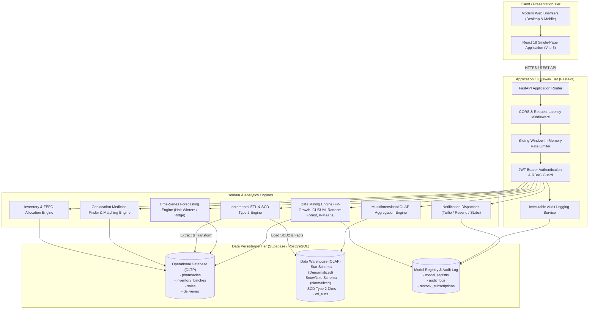
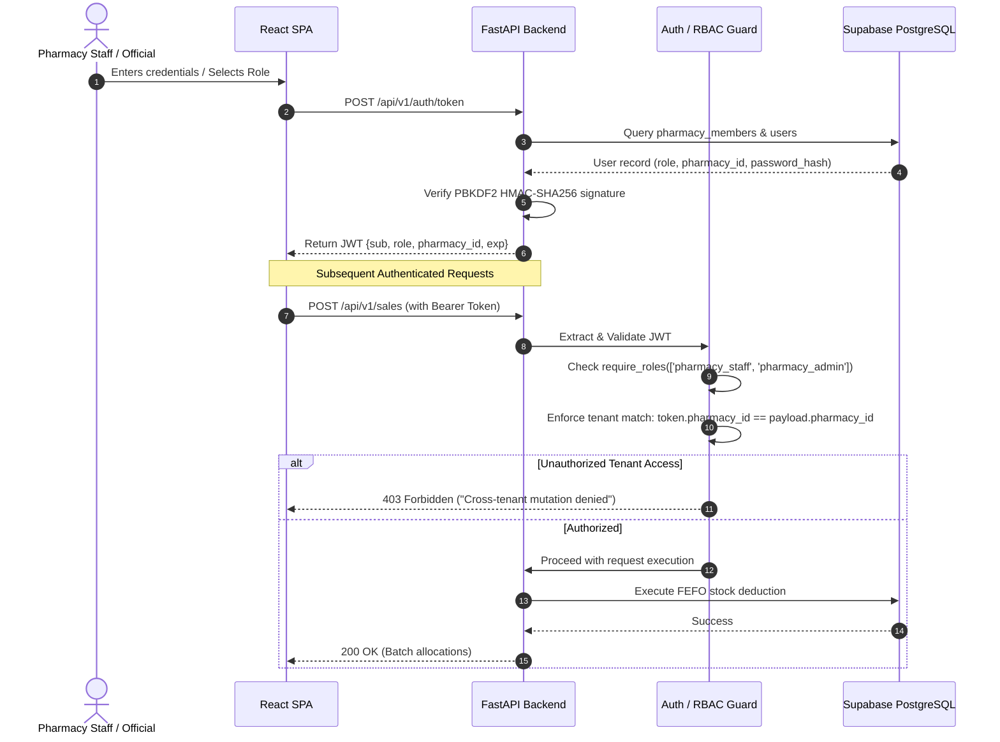
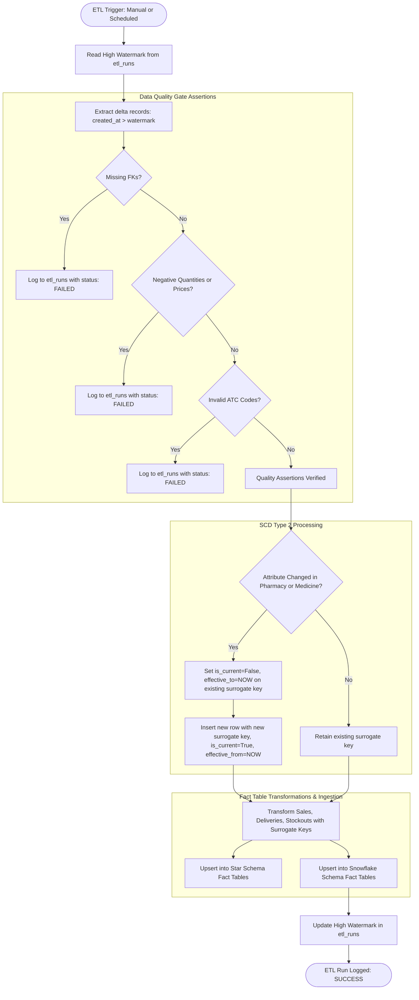
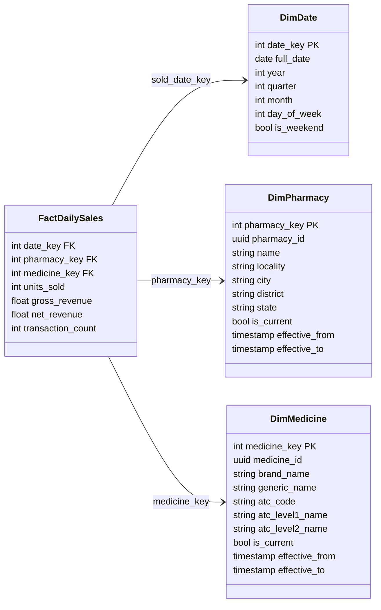
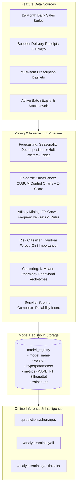
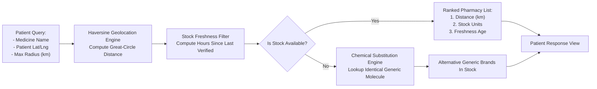
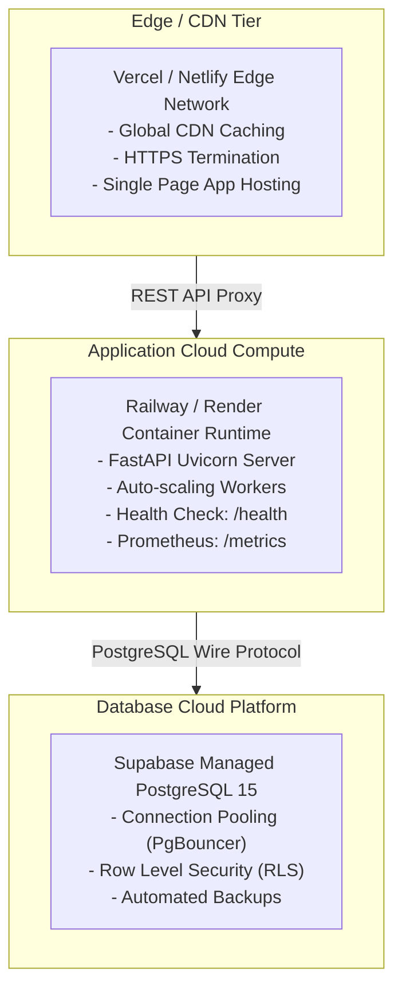

# MediPulse AI: Architecture & System Design Specification

This document provides a comprehensive technical reference for the architecture, component interaction, data flow, and security model of **MediPulse AI**.

---

## 1. System Overview

MediPulse AI is an enterprise-grade healthcare analytics and supply-chain intelligence platform designed to eliminate localized medicine shortages through real-time inventory tracking, multi-dimensional OLAP analytics, and predictive data mining.

### Architectural Philosophy
1. **Decoupled OLTP and OLAP**: Operational transactions (FEFO sales, batch arrivals) are isolated from analytical queries through an incremental ETL pipeline that feeds dual Star and Snowflake warehouse schemas.
2. **Multi-Tenancy by Design**: Strict tenant isolation ensures pharmacies can only view and modify their own stock levels, while designated public health authorities receive aggregated regional intelligence without cross-tenant leakage.
3. **Defense-in-Depth Security**: Layered security encompassing JWT claims validation, role-based access control (RBAC), PostgreSQL Row-Level Security (RLS) policies, sliding-window rate limiting, and immutable audit logs.
4. **Resilient Local & Cloud Execution**: A dual-mode repository layer transparently switches between live PostgreSQL/Supabase and an in-memory PostgREST emulator, enabling full offline development, testing, and continuous integration without cloud dependencies.

---

## 2. High-Level Component Topology

---

## 3. Core Component Specifications

### 3.1 Authentication, RBAC, and Multi-Tenancy

Every API request undergoes strict authorization checks based on user identity, assigned role, and pharmacy affiliation:

#### Role Permission Matrix

| Role | Operational Scope | Allowed Capabilities |
|---|---|---|
| `pharmacy_staff` | Single Tenant | View batch stock, record FEFO sales, record physical stock verification. |
| `pharmacy_admin` | Single Tenant | All staff capabilities + bulk CSV/Excel import, purchase order deliveries, member audit logs. |
| `health_official` | Multi-Tenant / Regional | Read-only access to all pharmacy stocks, community shortage analytics, OLAP explorer, epidemiological surge alerts, and retrain ML models. |
| `patient` | Public / Anonymized | Search medicine availability, view distance/freshness, view generic substitutes, submit reservation confirmation requests, subscribe to restock alerts. |

---

## 4. Operational to Analytical Data Pipeline (ETL & OLAP)

### 4.1 Incremental ETL & Slowly Changing Dimensions (SCD Type 2)

The ETL process runs incrementally using high-watermark timestamps to prevent full table reloads, minimizing database I/O while guaranteeing consistency:

### 4.2 Dual Data Warehouse Topology: Star vs. Snowflake

MediPulse AI offers dual-schema querying to demonstrate multidimensional data warehousing paradigms:

*In the Snowflake schema, `DimMedicine` normalizes into `DimATCTier1`, `DimATCTier2`, and `DimDosageForm`, while `DimPharmacy` normalizes into `DimDistrict`, `DimCity`, and `DimLocality`.*

---

## 5. Machine Learning & Data Mining Architecture

### 5.1 Forecasting Engine
- **Methodology**: Additive day-of-week seasonality decomposition combined with Holt-Winters triple exponential smoothing and Ridge regression.
- **Safety Stock Optimization**:
  $$SS = Z \times \sqrt{L \cdot \sigma_D^2 + D^2 \cdot \sigma_L^2}$$
  Where $Z = 1.65$ (95% service level), $L$ is expected supplier lead time, $\sigma_D$ is demand variance, and $\sigma_L$ is delivery lead time variance.
- **Confidence Intervals**: $\hat{y}_t \pm 1.96 \cdot \hat{\sigma}_{\text{residuals}}$.
- **Cold-Start Strategy**: Unobserved or newly registered medicines inherit demand distribution vectors from their corresponding therapeutic ATC cluster.

---

## 6. Real-Time Patient Finder & Geolocation Matching

---

## 7. Security, Tenancy, and Compliance Model

1. **Authentication Token Lifecycle**:
   - Access tokens are HMAC-SHA256 signed JSON Web Tokens (JWT) expiring in 24 hours.
   - Tokens encapsulate claims: `{ "sub": user_id, "role": user_role, "pharmacy_id": tenant_id }`.
2. **PostgreSQL Row-Level Security (RLS)**:
   - For all tenant-scoped tables (`inventory_batches`, `sales`, `deliveries`), PostgreSQL RLS policies enforce `auth.uid() IN (SELECT user_id FROM pharmacy_members WHERE pharmacy_id = table.pharmacy_id)`.
3. **Audit Immutability**:
   - Stock adjustments, manual count overrides, and batch additions generate records in `audit_logs` capturing `user_id`, `pharmacy_id`, `action`, `resource_id`, `before_state`, `after_state`, and `timestamp`.
4. **Public Endpoint Rate Limiting**:
   - Patient search and restock alert endpoints are protected by an in-memory sliding-window limiter enforcing a strict maximum of 60 requests per minute per IP address.

---

## 8. Deployment Topology

- **Containerization**: Both frontend and backend feature multi-stage production Dockerfiles with a unifying `docker-compose.yml` for unified one-command local orchestration.
- **Observability**: Real-time health probes at `/health` and native Prometheus metric scrapers at `/metrics` exporting request counts, latencies, and active model versions.

