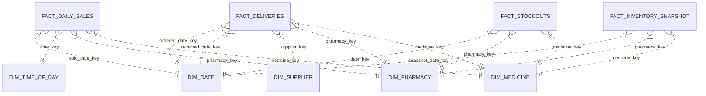
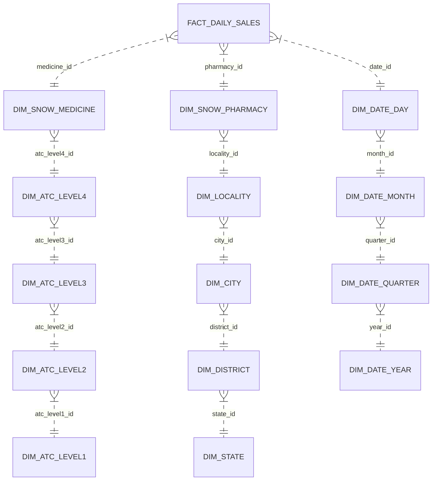

# MediPulse AI: Data Warehouse & OLAP Architecture Specification

## 1. Overview & System Purpose
MediPulse AI is a predictive medicine availability and community shortage intelligence system. The system bridges operational pharmacy inventory (OLTP) and analytical decision support (OLAP) using a modern data warehouse coupled with data mining pipelines.

The analytical engine powers:
- Multi-echelon stockout risk analysis and 7-day demand forecasting.
- Regional epidemic and demand surge detection.
- Supplier fulfillment latency and delay scoring.
- Co-dispensing association rule mining (basket analysis).
- Interactive multidimensional OLAP exploration across time, geographic areas, medicine categories (ATC classification), and pharmacy chains.

---

## 2. Dual Warehouse Design: Star vs. Snowflake Schema

MediPulse AI implements both **Star Schema** and **Snowflake Schema** designs to demonstrate multidimensional modeling trade-offs:

### 2.1 Star Schema (De-normalized for High-Speed Aggregations)
In the star schema, dimension tables are intentionally denormalized into wide tables with surrogate keys. This minimizes SQL `JOIN` overhead and maximizes query performance for OLAP slice-and-dice queries.

#### Star Schema Fact Tables
1. **`fact_daily_sales`**:
   - Grain: One row per pharmacy per medicine per date per time bucket.
   - Measures: `units_sold`, `gross_revenue`, `discount_amount`, `net_revenue`, `transaction_count`.
2. **`fact_deliveries`**:
   - Grain: One row per purchase order delivery receipt.
   - Measures: `quantity_ordered`, `quantity_received`, `lead_time_days`, `delay_days`, `fill_rate_pct`, `is_delayed`.
3. **`fact_stockouts`**:
   - Grain: One row per detected stockout event per medicine per pharmacy.
   - Measures: `duration_hours`, `estimated_unmet_demand`, `revenue_lost_est`, `severity_score`.
4. **`fact_inventory_snapshot`**:
   - Grain: Daily snapshot of stock levels.
   - Measures: `quantity_on_hand`, `days_of_supply`, `expiring_30d_qty`, `safety_stock_level`, `risk_score`.

#### Star Schema Dimension Tables
- **`dim_date`**: `date_key (YYYYMMDD)`, `full_date`, `day_of_week`, `day_name`, `is_weekend`, `week_of_year`, `month`, `month_name`, `quarter`, `year`.
- **`dim_time_of_day`**: `time_key`, `hour_24`, `minute`, `time_bucket` (Early Morning, Morning, Afternoon, Evening, Night).
- **`dim_pharmacy`** (SCD Type 2): `pharmacy_key` (surrogate), `pharmacy_id` (business key), `name`, `license_no`, `address_line`, `locality`, `city`, `district`, `state`, `postal_code`, `lat`, `lng`, `verification_status`, `effective_from`, `effective_to`, `is_current`.
- **`dim_medicine`** (SCD Type 2): `medicine_key` (surrogate), `medicine_id` (business key), `generic_name`, `brand_name`, `strength`, `dosage_form`, `atc_code`, `atc_level1_name`, `atc_level2_name`, `atc_level3_name`, `manufacturer`, `unit_cost`, `selling_price`, `effective_from`, `effective_to`, `is_current`.
- **`dim_supplier`**: `supplier_key`, `supplier_id`, `name`, `contact_name`, `phone`, `email`, `typical_lead_time_days`, `reliability_score`, `city`, `state`.
- **`dim_area`**: `area_key`, `locality`, `city`, `district`, `state`, `postal_code`, `zone`.

---

### 2.2 Snowflake Schema (Normalized Dimension Hierarchies)
The Snowflake Schema normalizes dimension tables into 3NF hierarchies, eliminating redundancy in dimensional attributes such as ATC classification levels and geographic jurisdictions.

#### Snowflake Dimension Hierarchies
1. **Medicine ATC Hierarchy**:
   - `dim_atc_level1` (Anatomical Main Group, e.g., `A` Alimentary tract and metabolism, `J` Anti-infectives, `C` Cardiovascular)
   - `dim_atc_level2` (Therapeutic Subgroup, e.g., `J01` Antibacterials for systemic use)
   - `dim_atc_level3` (Pharmacological Subgroup, e.g., `J01C` Beta-lactam antibacterials)
   - `dim_atc_level4` (Chemical Subgroup, e.g., `J01CA` Penicillins with extended spectrum)
   - `dim_snow_medicine` (Chemical Substance & Product, e.g., Amoxicillin 500mg Capsule)
2. **Geographical Hierarchy**:
   - `dim_state` -> `dim_district` -> `dim_city` -> `dim_locality` -> `dim_snow_pharmacy`
3. **Temporal Hierarchy**:
   - `dim_date_year` -> `dim_date_quarter` -> `dim_date_month` -> `dim_date_day`

---

## 3. Incremental ETL Architecture & SCD Type 2

### 3.1 ETL Pipeline Stages
1. **Extract**:
   - Reads transactional data from OLTP tables (`sales`, `inventory_batches`, `purchase_orders`, `stock_movements`) using change-data-capture watermarks (`updated_at > last_watermark`).
2. **Transform & Quality Assurance Checks**:
   - Rejection of null foreign keys.
   - Quantity boundary assertions (`quantity > 0`, `lead_time >= 0`).
   - Deduplication and surrogate key lookups.
   - Outlier detection and logging in `etl_anomalies`.
3. **Load**:
   - Incremental upsert into fact tables.
   - SCD Type 2 handling on `dim_medicine` and `dim_pharmacy`:
     - If attributes (selling price, reorder level, address, license) change, expire the existing row (`effective_to = current_timestamp`, `is_current = FALSE`) and insert a new version (`effective_from = current_timestamp`, `effective_to = '9999-12-31'`, `is_current = TRUE`).
4. **Audit & Monitoring**:
   - Every ETL execution logs to `etl_runs` (`run_id`, `source_system`, `status`, `rows_extracted`, `rows_loaded`, `rows_rejected`, `duration_seconds`, `started_at`, `completed_at`).

---

## 4. Multidimensional OLAP Cube Operations

The analytical engine executes multidimensional analysis utilizing SQL-99 OLAP extensions (`GROUP BY CUBE`, `ROLLUP`, and `GROUPING SETS`) as well as in-memory multi-way aggregations:

### 4.1 Supported OLAP Operations
1. **Roll-up (Consolidation)**:
   - Aggregating up geographic hierarchy: Locality $\rightarrow$ City $\rightarrow$ District $\rightarrow$ State $\rightarrow$ National.
   - Aggregating up time hierarchy: Day $\rightarrow$ Week $\rightarrow$ Month $\rightarrow$ Quarter $\rightarrow$ Year.
2. **Drill-down (De-aggregation)**:
   - Navigating from ATC Level 1 category down to specific generic molecules and dosage forms.
3. **Slice and Dice**:
   - Slice: Filter by `district = 'Chennai'`.
   - Dice: Sub-cube of `quarter IN ('Q1-2024', 'Q2-2024')` AND `category IN ('Antibiotics', 'Antidiabetics')` AND `risk_level = 'CRITICAL'`.
4. **Pivot (Cross-tabulation)**:
   - Rows: Medicine Categories; Columns: Calendar Months; Cells: Total Units Sold / Out of Stock Days.

### 4.2 Core OLAP Measures
- **Units Sold ($V$)**: $\sum \text{quantity}$
- **Stock-Out Events ($S$)**: Count of instances where inventory was zero while demand was non-zero.
- **Days of Cover ($DoC$)**: $\frac{\text{Current Stock On Hand}}{\text{Average Daily Demand Rate}}$
- **Average Lead Time & Delay ($\bar{L}, \bar{D}$)**: Mean delivery duration and variance beyond promised arrival date.
- **Period-over-Period (PoP) Growth**: $\frac{M_t - M_{t-1}}{M_{t-1}} \times 100\%$

---

## 5. Advanced Data Mining Integration

1. **Association Rule Mining (Market Basket Analysis)**:
   - Target: `sale_baskets` table containing co-purchased items per transaction.
   - Algorithms: Frequent Pattern Growth (FP-Growth) and Apriori.
   - Metrics: Support, Confidence, Lift, and Conviction. Identifies commonly paired treatments (e.g., Amoxicillin + Clavulanate + Paracetamol).
2. **Epidemic / Demand Surge Detection**:
   - Methods: Cumulative Sum Control Chart (CUSUM) and STL (Seasonal and Trend decomposition using Loess).
   - Flags statistically anomalous deviations ($Z > 2.5$) in respiratory, antiviral, or antibiotic sales in localized geographic clusters.
3. **Shortage Risk Classification**:
   - Supervised classification (Random Forest Classifier) predicting `shortage_risk_level` (Low, Medium, High, Critical) based on historical demand velocity, stock volatility, supplier delay frequency, and lead-time dispersion.
4. **Pharmacy Behavioral Clustering**:
   - K-Means ($k=3..5$) grouping pharmacies into operational profiles: High-Volume Urban, Moderate Suburban, and Low-Stock High-Risk Outlier pharmacies.
5. **Supplier Reliability Scoring**:
   - Weighted composite index computed from on-time delivery rate, fill rate, and lead-time standard deviation.
