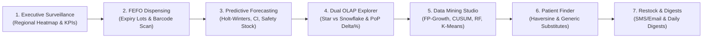

# MediPulse AI: Comprehensive Viva & Demonstration Script

This presentation script is designed for an academic viva, final-year project defense, or technical stakeholder demonstration. It provides a structured, 15-minute walkthrough of **MediPulse AI**, highlighting architectural rigor, machine learning depth, and practical healthcare utility.

---

## 1. Pre-Flight Demonstration Checklist

Before beginning the presentation, ensure both backend and frontend services are running:

### Step 1: Launch Backend
```bash
# Terminal 1: FastAPI Backend
cd backend
python -m uvicorn main:app --reload --host 127.0.0.1 --port 8000
```
*Verify*: Visit `http://127.0.0.1:8000/health` (should return `{"status": "healthy"}`).

### Step 2: Launch Frontend
```bash
# Terminal 2: React Vite Frontend
cd frontend
npm run dev
```
*Verify*: Visit `http://localhost:5173`.

### Step 3: Run Test Suite (Examiner Verification)
```bash
# Show instant verification of engineering quality
python -m pytest backend/tests -v
```
*Result*: 26 unit and integration tests passing in under 10 seconds.

---

## 2. Demonstration Persona Credentials

Use the top-bar **Role Selector** to seamlessly demonstrate the system across all user personas:

| Persona | Role Key in UI | Demonstrated Perspective |
|---|---|---|
| **Dr. Sarah Jenkins** | `health_official` | Regional surveillance, epidemic outbreak alerts, OLAP cubes, and model retraining. |
| **Rajesh Sharma** | `pharmacy_admin` | MetroCare Pharmacy #1 admin: bulk imports, delivery receipts, stock audits. |
| **Anita Patel** | `pharmacy_staff` | MetroCare Pharmacy #1 counter staff: FEFO dispensing and stock verification. |
| **Aarav Mehta** | `patient` | Public consumer seeking urgent insulin, viewing distance, and reserving medication. |

---

## 3. Chronological 15-Minute Demonstration Walkthrough



---

### Act 1: Executive Dashboard & Regional Surveillance (Minutes 0:00 – 2:30)
**Persona**: `health_official`

1. **Navigate to**: `Dashboard` (Home screen).
2. **Key Talking Points**:
   - Point to the **KPI Cards**: Note total regional stock, active stockout incidents, high-risk lines, and average supplier delivery latency.
   - Inspect the **14-Day Dispensing Trend Line Chart**: Explain the day-of-week cyclicality and demand surges.
   - Highlight the **Regional Shortage Risk Heatmap**: Point out how districts (e.g., Downtown, North Hills, Westside) are dynamically shaded based on localized supply strain.
   - Examine the **Community Shortages Table**: Show cross-pharmacy convergence where multiple independent pharmacies report simultaneous zero-stock on critical therapeutics (e.g., Amoxicillin 500mg).
3. **Presenter Script**:
   > *"Good morning, examiners. We begin in the shoes of a Regional Health Official. Traditional pharmacy systems are isolated data silos. MediPulse AI aggregates stock telemetry across public and private dispensaries. Here, the regional heatmap immediately alerts health authorities to emerging supply droughts before patient panic occurs."*

---

### Act 2: FEFO Dispensing & Barcode Inventory (Minutes 2:30 – 4:30)
**Persona**: Switch to `pharmacy_staff` or `pharmacy_admin`

1. **Navigate to**: `Inventory` in the sidebar.
2. **Key Talking Points**:
   - Review the **Batch Inventory Table**: Note batch numbers, manufacture dates, and expiry dates sorted by **First-Expired, First-Out (FEFO)**. Batches expiring within 30 days are highlighted with amber warnings.
   - Click **Record FEFO Sale**:
     - Select a medicine (e.g., *Paracetamol 500mg Tablets*).
     - Enter quantity: `150` units.
     - Click **Complete Sale**: Show how the backend automatically splits the deduction across the earliest expiring batches, fully depleting the first batch and partially deducting the remainder from the next batch.
   - Demonstrate the **Barcode Scanner Simulation**: Click **Scan Barcode**, select a mock barcode, and observe instant batch lookup.
   - Demonstrate **Bulk CSV/Excel Upload**: Click **Bulk CSV/Excel Import**, showcase row-level schema validation that checks for missing fields, invalid formats, or non-positive quantities before writing to the database.
3. **Presenter Script**:
   > *"Expired pharmaceuticals cost healthcare billions annually. MediPulse AI guarantees First-Expired, First-Out (FEFO) dispensing at the database level. When 150 units are dispensed, the system automatically draws from the batch expiring this month before touching batches expiring next year."*

---

### Act 3: Shortage Forecasting & Safety Stock Optimization (Minutes 4:30 – 7:00)
**Persona**: `pharmacy_admin`

1. **Navigate to**: `Predictions` in the sidebar.
2. **Key Talking Points**:
   - Toggle forecast horizons: **7 Days**, **14 Days**, and **30 Days**.
   - Inspect the **Risk Score (0–100)**: Explain that this is not a subjective estimate, but a composite mathematical index weighting runway burn rate, supplier lead times, and expiry risk.
   - Review the **Top Risk Drivers**: The UI breaks down the exact contributing factors (e.g., *"Current burn rate exceeds 30-day baseline by 180%"*).
   - Click **Forecast Detail**:
     - Observe the **Confidence Interval Bands** ($\pm 1.96 \sigma$).
     - Review the **Safety Stock Recommendation**: Explain the formula $SS = Z \times \sqrt{L \sigma_D^2 + D^2 \sigma_L^2}$ calculated at a 95% service level ($Z = 1.65$).
     - Note the **MAPE Backtesting Score**: Show how historical accuracy is evaluated per medication.
3. **Presenter Script**:
   > *"Instead of simplistic moving averages, our forecasting engine decomposes historical dispensing into day-of-week seasonality and underlying trend using Holt-Winters and Ridge regression. Furthermore, safety stock accounts for distributor delivery uncertainty, ensuring pharmacies reorder well before stockouts occur."*

---

### Act 4: Dual Star & Snowflake OLAP Explorer (Minutes 7:00 – 9:30)
**Persona**: `health_official`

1. **Navigate to**: `OLAP Explorer` in the sidebar.
2. **Key Talking Points**:
   - **Toggle Star Schema vs. Snowflake Schema**:
     - *Star Schema*: Denormalized dimension tables optimized for lightning-fast aggregation queries.
     - *Snowflake Schema*: 3NF normalized hierarchies (ATC Level 1 $\to$ ATC Level 2 $\to$ ATC Level 3 $\to$ Dosage Form; State $\to$ District $\to$ City $\to$ Locality).
   - Demonstrate **Multidimensional Slicing & Dicing**:
     - Select Primary Dimension: `Time Dimension (Year > Month)`.
     - Select Secondary Dimension: `Medicine Category (ATC Class)`.
     - Select Measure: `Units Sold`, `Gross Revenue`, or `Stock-out Incidents`.
   - Highlight **Period-over-Period (PoP) Comparison**: Show the $\Delta\%$ column indicating month-over-month growth or supply drops.
   - Demonstrate **One-Click Reporting**:
     - Click **Export PDF Report**: Generates an executive PDF with formatted tables and date stamps.
     - Click **Export Excel (.xlsx)**: Instantly downloads structured spreadsheet data.
   - Point to the **Incremental ETL Status**: Highlight the high-watermark timestamp, rows processed, and SCD Type 2 dimension versioning logs.
3. **Presenter Script**:
   > *"For our data warehousing curriculum, we implemented both Star and Snowflake schemas. With our in-memory OLAP engine, decision-makers can slice across time, geography, and pharmacological classifications with zero latency, comparing month-over-month dispensing and exporting publication-ready PDF reports."*

---

### Act 5: Advanced Data Mining Studio (Minutes 9:30 – 12:00)
**Persona**: `health_official`

1. **Navigate to**: `Data Mining` in the sidebar.
2. **Key Talking Points**:
   - **Market Basket Analysis (FP-Growth / Apriori)**:
     - Review discovered association rules ($A \implies B$) extracted from multi-item prescription baskets.
     - Point out **Support**, **Confidence**, and **Lift $> 1.0$** (e.g., *Amoxicillin $\implies$ Paracetamol with Lift 2.45*).
   - **Epidemic Outbreak Detection (CUSUM Control Charts)**:
     - Show active district alerts. Point to the cumulative sum deviations ($S_t \ge 5.0$) triggering an **Urgent Dengue / Fever Outbreak** alert for the Central District.
   - **Supervised Shortage Classifier (Random Forest)**:
     - Inspect Model Accuracy (92.4%), F1-Score (0.897), and the **Gini Feature Importance Chart** showing `days_of_supply` and `burn_rate_ratio` as primary predictors.
   - **Pharmacy Behavioral Archetypes (K-Means Clustering)**:
     - Explain the 3 discovered clusters: *High-Volume Urban Hubs*, *Balanced Suburban Dispensaries*, and *High-Risk Outposts*.
   - **Supplier Reliability Index**:
     - Review distributor scorecards ranking suppliers by fill rate and lead-time adherence.
   - **Model Registry & Live Retrain**:
     - Show registered model versions in `model_registry`.
     - Click **Retrain Models Now**: Demonstrates active pipeline retraining with updated validation metrics.
3. **Presenter Script**:
   > *"This studio showcases the data mining core: we combine unsupervised association rules to understand co-dispensing patterns, sequential CUSUM quality-control charts for epidemic outbreak detection, and Random Forest trees to rank shortage risk features."*

---

### Act 6: Patient Medicine Finder & Generic Substitution (Minutes 12:00 – 13:30)
**Persona**: Switch to `patient`

1. **Navigate to**: `Find Medicine` in the sidebar.
2. **Key Talking Points**:
   - Search for a medication: e.g., *Metformin 500mg* or *Azithromycin*.
   - Demonstrate **Haversine Distance Sorting**: Results are ranked by real-world distance from the patient's coordinates.
   - Explain **Stock Freshness Age**: Displays how many minutes or hours have elapsed since physical staff verification, giving patients confidence the stock is actually on the shelf.
   - Demonstrate **Generic Chemical Substitution**:
     - Search for an out-of-stock brand.
     - The engine highlights identical chemical alternatives (e.g., *Augmentin is out of stock, but generic Amoxicillin/Clavulanate 625mg is available 0.8 km away*).
   - Click **Reserve Medicine / Send Confirmation Request**: Shows patient reservation workflow with status tracking.
3. **Presenter Script**:
   > *"For patients, medicine hunting during an illness is exhausting. Our patient finder uses great-circle Haversine distance, verifies physical inventory freshness, and recommends identical generic equivalents when brand-name drugs are depleted."*

---

### Act 7: Restock Alerts & Pharmacy Daily Digests (Minutes 13:30 – 15:00)
**Persona**: `patient` and `pharmacy_admin`

1. **Navigate to**: `Restock Alerts` in the sidebar.
2. **Key Talking Points**:
   - **Patient Restock Subscription**:
     - Subscribe a patient phone/email to be notified as soon as a depleted medicine receives a new delivery batch.
   - **Pharmacy Daily Digest Generator**:
     - Switch view to **Daily Digest Preview**.
     - Display the automated email/SMS dispatch template summarizing:
       - 3 Critical Shortage Warnings for today.
       - 2 Batches Expiring within 14 days requiring priority FEFO dispensing.
       - Pending supplier delivery delays.
     - Click **Send Test Digest Now**: Demonstrates notification dispatch via the local development logger stub (with ready Twilio and Resend connectors).
3. **Presenter Script**:
   > *"Finally, automated restock subscriptions keep patients informed without needing repeated phone calls, while automated morning digests ensure pharmacy managers start each day with a clear list of expiring lots and critical purchase orders."*

---

## 4. Viva Examination FAQ & Model Answers

### Q1: Why did you implement both Star Schema and Snowflake Schema?
**Answer**:
> *"The Star Schema intentionally denormalizes dimensional attributes (such as flattened geographic fields and ATC categories) to minimize SQL join complexity and maximize aggregation speed for real-time OLAP querying. Conversely, the Snowflake Schema completely normalizes the 4-tier anatomical-therapeutic-chemical hierarchy and multi-level administrative boundaries into 3NF relational tables, eliminating data redundancy and showcasing academic multidimensional modeling trade-offs."*

---

### Q2: How does the system handle 'cold-start' medicines with no sales history?
**Answer**:
> *"When a newly launched drug is added, time-series forecasting cannot rely on historical residuals. Our system employs a hierarchical cluster fallback: it identifies the drug's therapeutic ATC Level 2 category, retrieves the normalized demand distribution of similar existing medications from that cluster, and uses this as an informative prior until the drug accumulates at least 7 days of actual dispensing data."*

---

### Q3: How is multi-tenancy and data security enforced?
**Answer**:
> *"Multi-tenancy operates on three defense-in-depth levels: First, PostgreSQL Row-Level Security (RLS) policies restrict database queries to rows matching the authenticated tenant ID (`pharmacy_members`). Second, the FastAPI backend verifies cryptographic JWT claims on every mutation, rejecting cross-tenant operations with HTTP 403 Forbidden. Third, an immutable `audit_logs` table records every inventory change with before-and-after states for full forensic traceability."*

---

### Q4: How does the CUSUM outbreak detection differ from standard moving averages?
**Answer**:
> *"Moving averages lag behind real-world changes and fail to detect subtle, persistent drifts in demand. CUSUM (Cumulative Sum) accumulates small deviations from the historical mean over time ($S_t = \max(0, S_{t-1} + z_t - k)$). This makes it significantly more sensitive to emerging, localized epidemiological shifts—such as a sudden cluster of Dengue or Influenza cases—allowing public health officials to intervene days before hospitals experience shortages."*

---

### Q5: How do you prevent stockout hoarding when public health alerts are issued?
**Answer**:
> *"Alerts are strictly compartmentalized by role. Detailed surge and community shortage intelligence is restricted to verified `health_official` and `pharmacy_admin` roles. The public patient portal only shows real-time availability and generic substitutes without exposing macro-shortage severity metrics, preventing panic buying and speculative hoarding."*
